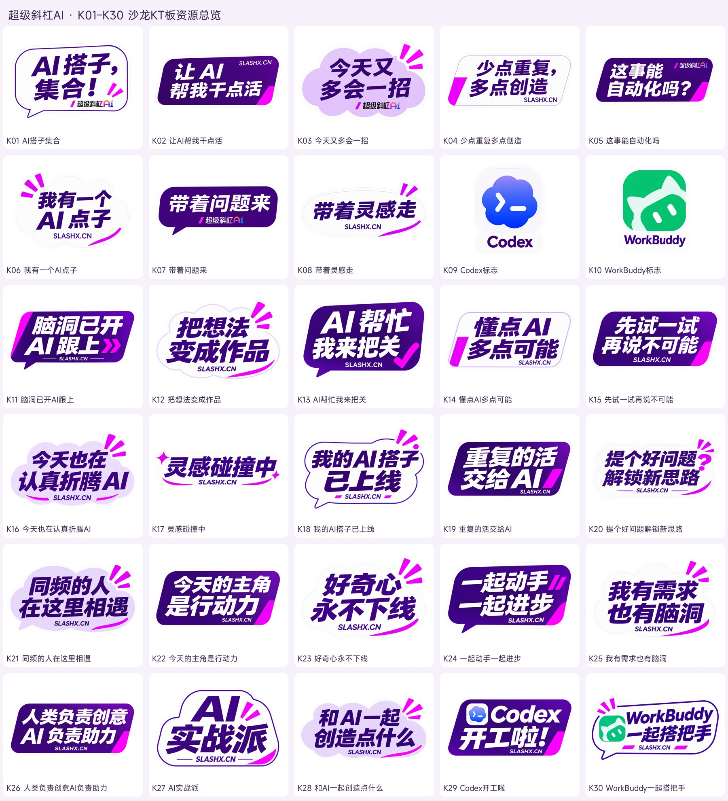

# 沙龙 KT 板与合影手持牌

收录 2026-11-16 线下沙龙物料项目的 K01–K30 共 30 张透明 PNG：原版 10 款与追加 20 款。按编号或文案选择，优先复用现有图片的字形、造型、配色、白边和比例。

## 取用方法

- 图片位于 `assets/event-signage/kt-boards/K01.png` 至 `K30.png`；PNG 与原文件逐字节一致，保留透明通道及原始像素尺寸。
- [结构化目录](../assets/event-signage/kt-boards/catalog.json)记录编号、文案、历史建议成品尺寸、像素尺寸、来源与 SHA256。目录中的 `path` 相对技能的 `assets/`。
- 通过 `assets/brand.json` 的 `event_signage.kt_boards` 查找目录和总览。具体文件可交给 `scripts/brand_assets.py` 的 `asset_path()` 读取。
- 复用与局部改版保留原图字形和布局；改文案或新做款式时，把相近编号作为视觉参考，并检查生成文字与当前定稿 Logo。K09、K10、K29、K30 是 Codex / WorkBuddy 主题物料，不作为超级斜杠的主标志。

## 图片清单

尺寸为历史清单中的成品宽 × 高，单位 mm；像素为 PNG 原始画布。

| 编号 | 文案或主题 / 原图 | 历史成品尺寸 | PNG 像素 |
|---|---|---|---|
| K01 | [AI搭子集合](../assets/event-signage/kt-boards/K01.png) | 450 × 295 | 1536 × 1024 |
| K02 | [让AI帮我干点活](../assets/event-signage/kt-boards/K02.png) | 500 × 215 | 1779 × 884 |
| K03 | [今天又多会一招](../assets/event-signage/kt-boards/K03.png) | 450 × 275 | 1536 × 1024 |
| K04 | [少点重复多点创造](../assets/event-signage/kt-boards/K04.png) | 500 × 215 | 1801 × 873 |
| K05 | [这事能自动化吗](../assets/event-signage/kt-boards/K05.png) | 480 × 195 | 1774 × 887 |
| K06 | [我有一个AI点子](../assets/event-signage/kt-boards/K06.png) | 450 × 305 | 1536 × 1024 |
| K07 | [带着问题来](../assets/event-signage/kt-boards/K07.png) | 480 × 210 | 1774 × 887 |
| K08 | [带着灵感走](../assets/event-signage/kt-boards/K08.png) | 480 × 220 | 1774 × 887 |
| K09 | [Codex标志](../assets/event-signage/kt-boards/K09.png) | 400 × 500 | 1145 × 1374 |
| K10 | [WorkBuddy标志](../assets/event-signage/kt-boards/K10.png) | 400 × 485 | 1199 × 1312 |
| K11 | [脑洞已开AI跟上](../assets/event-signage/kt-boards/K11.png) | 500 × 245 | 1746 × 901 |
| K12 | [把想法变成作品](../assets/event-signage/kt-boards/K12.png) | 450 × 290 | 1536 × 1024 |
| K13 | [AI帮忙我来把关](../assets/event-signage/kt-boards/K13.png) | 450 × 290 | 1536 × 1024 |
| K14 | [懂点AI多点可能](../assets/event-signage/kt-boards/K14.png) | 500 × 235 | 1774 × 887 |
| K15 | [先试一试再说不可能](../assets/event-signage/kt-boards/K15.png) | 500 × 230 | 1774 × 887 |
| K16 | [今天也在认真折腾AI](../assets/event-signage/kt-boards/K16.png) | 450 × 270 | 1536 × 1024 |
| K17 | [灵感碰撞中](../assets/event-signage/kt-boards/K17.png) | 500 × 155 | 2172 × 724 |
| K18 | [我的AI搭子已上线](../assets/event-signage/kt-boards/K18.png) | 450 × 305 | 1536 × 1024 |
| K19 | [重复的活交给AI](../assets/event-signage/kt-boards/K19.png) | 500 × 230 | 1774 × 887 |
| K20 | [提个好问题解锁新思路](../assets/event-signage/kt-boards/K20.png) | 500 × 260 | 1743 × 902 |
| K21 | [同频的人在这里相遇](../assets/event-signage/kt-boards/K21.png) | 450 × 255 | 1663 × 945 |
| K22 | [今天的主角是行动力](../assets/event-signage/kt-boards/K22.png) | 500 × 230 | 1774 × 887 |
| K23 | [好奇心永不下线](../assets/event-signage/kt-boards/K23.png) | 450 × 300 | 1536 × 1024 |
| K24 | [一起动手一起进步](../assets/event-signage/kt-boards/K24.png) | 450 × 260 | 1536 × 1024 |
| K25 | [我有需求也有脑洞](../assets/event-signage/kt-boards/K25.png) | 450 × 290 | 1536 × 1024 |
| K26 | [人类负责创意AI负责助力](../assets/event-signage/kt-boards/K26.png) | 500 × 215 | 1774 × 887 |
| K27 | [AI实战派](../assets/event-signage/kt-boards/K27.png) | 450 × 290 | 1536 × 1024 |
| K28 | [和AI一起创造点什么](../assets/event-signage/kt-boards/K28.png) | 500 × 250 | 1752 × 897 |
| K29 | [Codex开工啦](../assets/event-signage/kt-boards/K29.png) | 500 × 240 | 1774 × 887 |
| K30 | [WorkBuddy一起搭把手](../assets/event-signage/kt-boards/K30.png) | 500 × 255 | 1672 × 941 |

## 来源与使用范围

K01–K10 取自原项目 `Canva原版交付-v001/分件原图/`，K11–K30 取自 `KT板追加20款-v001/生成原图/`。停用的重排印刷稿未作为来源。本次入库保留已有资源，不新增审美终审或打样通过记录。

这些文件是 RGB 栅格图片。图片画布、透明边缘与实际刀线不同，历史建议尺寸也不代表当前下单规格。实际制作需使用对应版本的刀线与出血设置，并按材料、色彩流程和实际尺寸打样；不要从预览总览图放大印刷。
